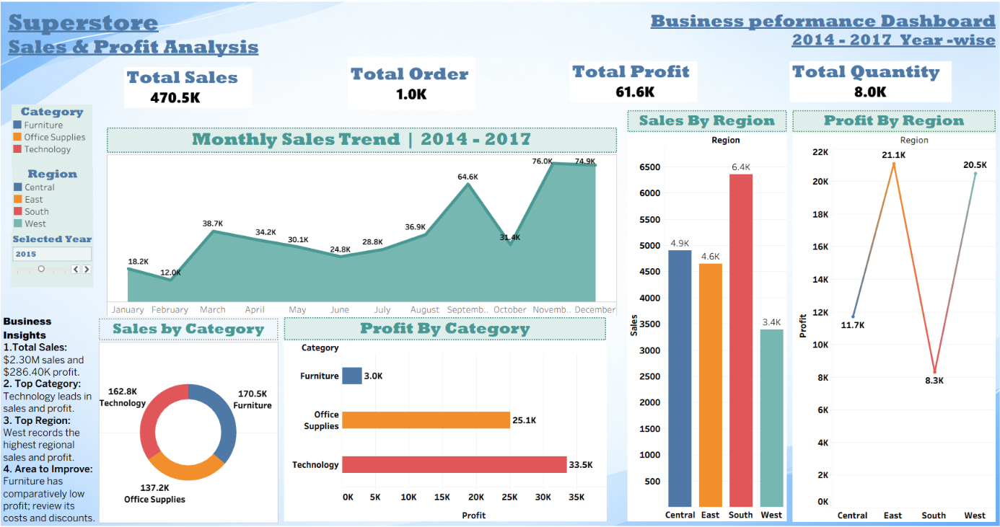

# Superstore Sales & Profit Analysis

## Project Overview
This is an end-to-end data analytics project focused on analyzing Superstore sales, profit, orders, product categories, and regional performance using Python and Tableau.

The project includes data inspection, data quality checks, exploratory data analysis (EDA), and an interactive Tableau dashboard to identify business trends and insights.

## Tools & Technologies
- Python
- Pandas
- NumPy
- Matplotlib
- Seaborn
- Google Colab
- Tableau

## Project Files
- `Sample - Superstore.csv` — Superstore dataset used for analysis.
- `Superstore_analysis.ipynb` — Python notebook containing data inspection, cleaning checks, and exploratory data analysis.
- `Superstore_sales_analysis_dashboard.twbx` — Tableau packaged workbook containing the sales and profit dashboard.

## Key Performance Indicators (KPIs)
- **Total Sales:** $2,297,200.86
- **Total Profit:** $286,397.02
- **Total Orders:** 5,009
- **Total Quantity Sold:** 37,873
- **Unique Customers:** 793

## Dashboard Features
- Monthly Sales Trend (2014–2017)
- Sales by Category
- Profit by Category
- Sales by Region
- Profit by Region
- KPI cards for sales, profit, orders, and quantity
- Year filter and category/region filters

## Key Business Insights
- **Top Category:** Technology generated the highest sales and profit among the three categories.
- **Top Region:** West recorded the highest overall sales and profit among the four regions.
- **Profitability Opportunity:** Furniture generated comparatively low profit relative to its sales.
- **Loss-Making Products:** Some sub-categories, including Tables and Bookcases, recorded losses.
- **Discount Analysis:** Higher discounts were associated with lower profitability in parts of the dataset.

## Project Workflow
1. Loaded and inspected the Superstore dataset.
2. Checked data quality, missing values, duplicates, and data types.
3. Performed exploratory data analysis using Python.
4. Analyzed sales and profit by category, region, and month.
5. Created a Tableau dashboard to visualize KPIs and business insights.

## Dataset Source
The dataset was obtained from Kaggle. Refer to the original dataset page for its license and attribution requirements.

## Objective
To analyze business performance, identify sales and profitability trends, and present meaningful insights through data visualization.
## Dashboard Preview

